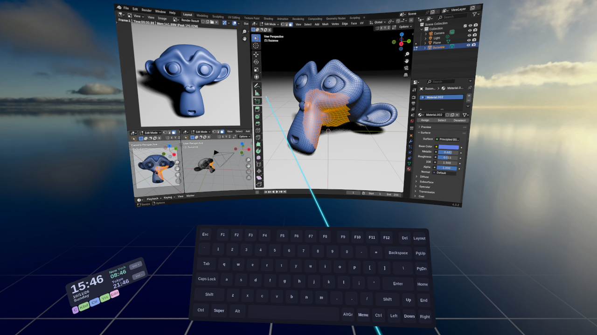
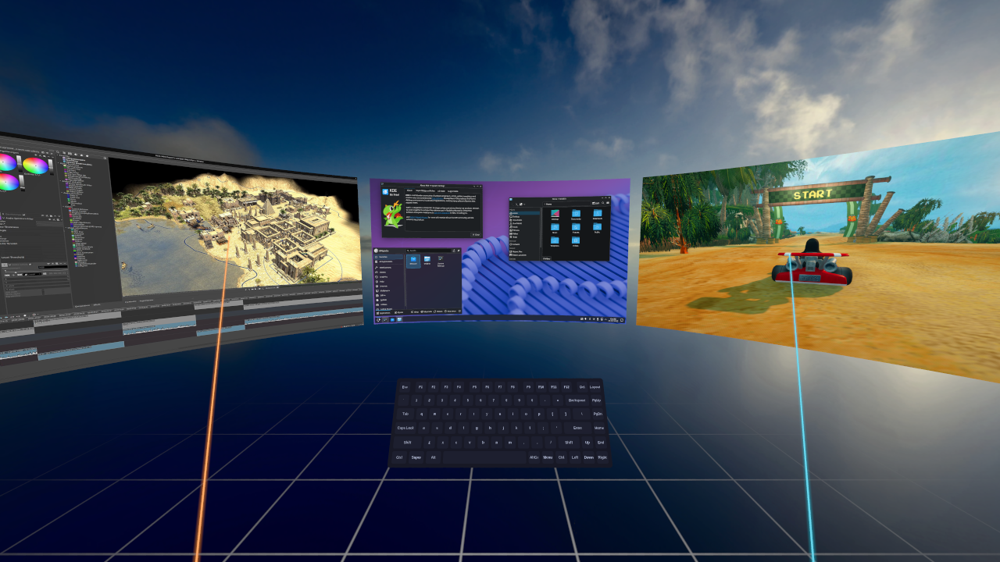
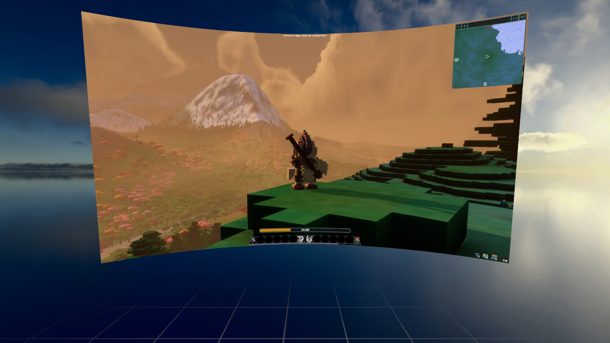
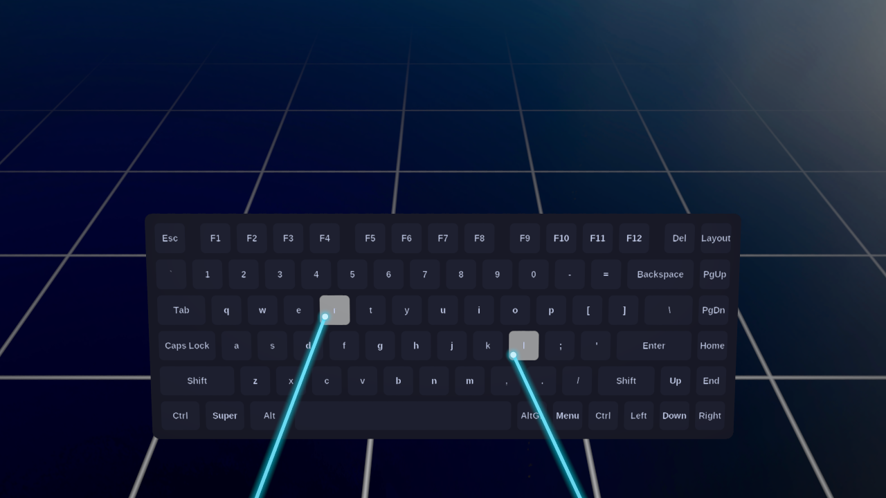
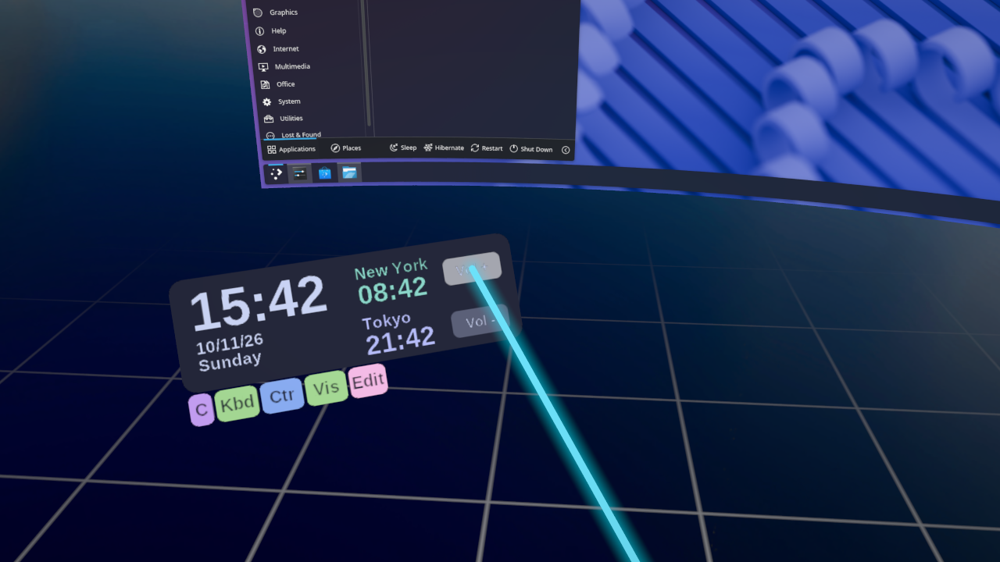
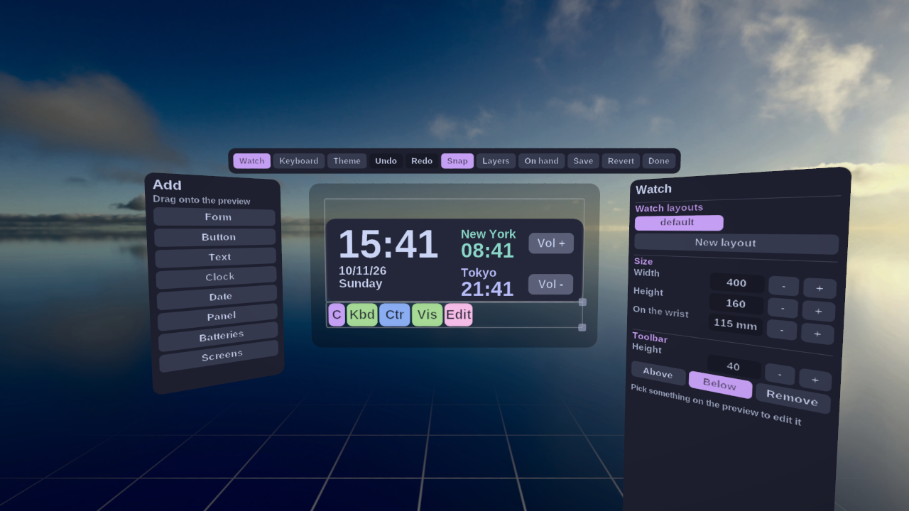
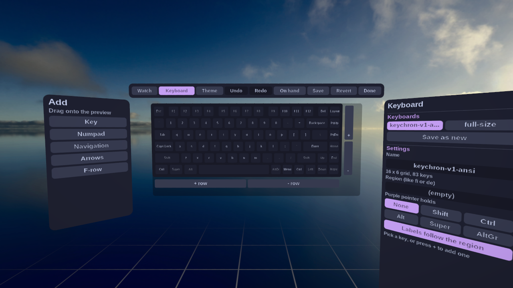
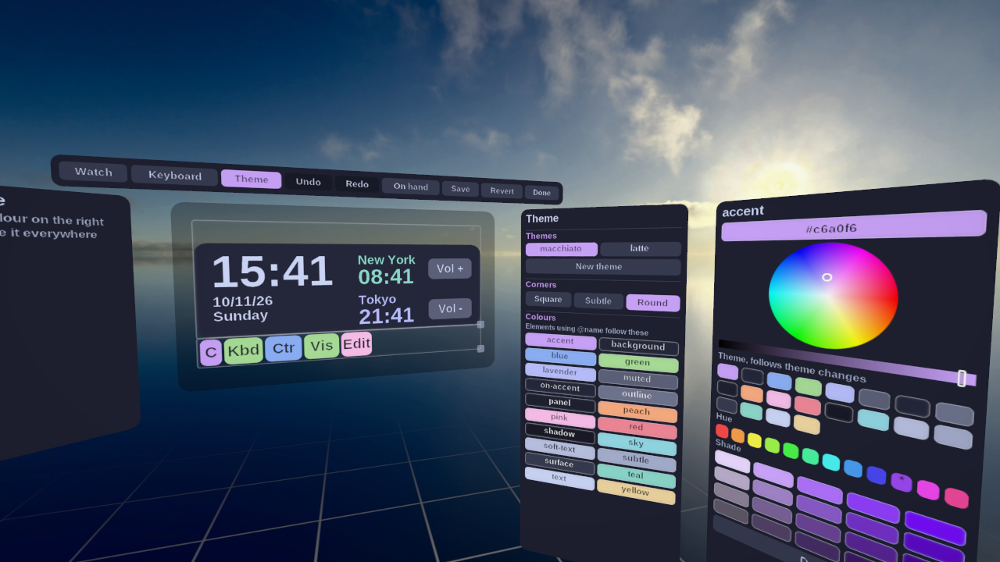

# FrameXR

> [!NOTE]
> This project is a C++ rewrite of [wlx-overlay-s](https://github.com/galister/wlx-overlay-s) (now [WayVR](https://github.com/wayvr-org/wayvr)), originally written in Rust. It was branched off release [v25.4.2](https://github.com/wayvr-org/wayvr/releases/tag/v25.4.2).

A modular, fully customizable VR overlay for SteamVR and Monado.

### Features

- Fully customizable everything with intuitive in-VR editor!
- Fully customizable keyboard, add, remove and rearrange keys however you like
- Speaks your language, Finnish, Swedish, Japanese or whatever layout you use, and switch between them on the fly
- Theme engine, pick your colours and go from sharp corners to fully rounded
- Crisp, shimmer-free screens even from far away
- Smooth, steady grabbing and pointing
- Overlays show up where you look and remember where you left them
- Works with both Monado (OpenXR) and SteamVR (OpenVR)
- Windows and Linux support

### Showcase

<p align="center">
  <a href="images/01-desktop.png"></a>
</p>
<p align="center">
  <a href="images/02-multi-monitor.png"></a>
  <a href="images/03-big-screen.png"></a>
</p>
<p align="center">
  <a href="images/04-keyboard.png"></a>
  <a href="images/05-watch.png"></a>
</p>
<p align="center">
  <a href="images/06-editor-watch.png"></a>
  <a href="images/07-editor-keyboard.png"></a>
  <a href="images/08-editor-theme.png"></a>
</p>

### Building from source

Requirements: a C++23 compiler (GCC 14+ or Clang 19+), Meson, Ninja, `glslangValidator`, and the development packages for Vulkan, Wayland, PipeWire, D-Bus, xkbcommon, FreeType, Fontconfig, OpenXR, X11/Xext/Xrandr, EGL/GLES and libdrm/gbm.

On Fedora:

```sh
sudo dnf install meson ninja-build gcc-c++ glslang vulkan-loader-devel wayland-devel wayland-protocols-devel \
    libxkbcommon-devel libxkbcommon-x11-devel dbus-devel freetype-devel fontconfig-devel pipewire-devel \
    openxr-devel mesa-libgbm-devel libdrm-devel mesa-libEGL-devel libX11-devel libXext-devel libXrandr-devel
```

Then:

```sh
git submodule update --init --recursive
meson setup build
ninja -C build
./build/src/framexr
```

Features can be toggled with `-D<feature>=disabled`: `openvr`, `openxr`, `osc`, `x11`, `wayland`.

Tests use googletest (vendored in `external/googletest`) and live in `tests/`:

- `meson test -C build --no-suite integration` runs the unit tests (`framexr-tests`) and the clang-format check.
- `meson test -C build --suite integration` runs `framexr-integration-tests`, which needs a GPU and a desktop session: it renders the watch, keyboard, settings and anchor panels to PNGs, drives pointer interaction (hover, click, grab, scroll, curvature) through the real input code, and captures the X display through XShm. Set `FRAMEXR_TEST_PW_TOKEN` to a ScreenCast restore token to also exercise PipeWire capture.

Log verbosity is controlled by the `FRAMEXR_LOG` environment variable (e.g. `FRAMEXR_LOG=debug` or `FRAMEXR_LOG=info,overlays/Screen=trace`).

## Known Issues

### X11 limitations

- X11 capture can generally seem slow. This is because zero-copy GPU capture is not supported on the general X11 desktop. Consider trying Wayland or Picom.
- DPI scaling is not supported and may cause the mouse to not follow the laser properly.
- Upright screens are not supported and can cause the mouse to act weirdly.
- Screen changes (connecting / disconnecting a display, resolution changes, etc) are not handled at runtime. Restart the overlay for these to take effect.

## Credits

- [galister](https://github.com/galister), thank you for your amazing work on wlx-overlay-s.

